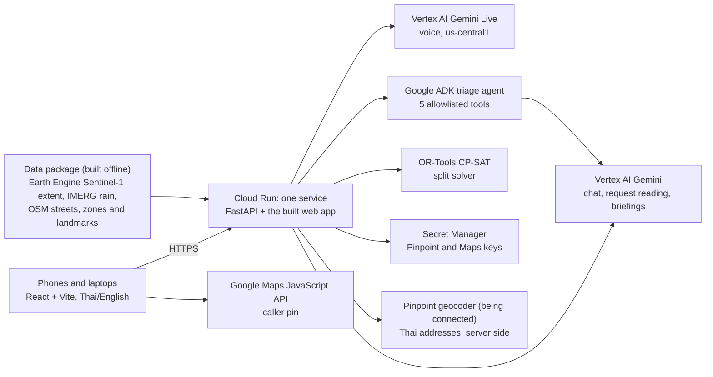

# ReachPoint

**ReachPoint turns flood reports, and gaps in reporting, into accountable rescue work, with status families can trust.**

AI Builder Cup 2026 (Google Cloud JAPAC) · Sustainability & Social Impact · built 12–17 Oct 2026 by a team of two.

- **Live demo:** _link added at deploy_ · open `/demo` for the three phones side by side
- **Video (under 3 min):** _link added on submission_ · **Deck (PDF):** _link added on submission_

## The problem

In the Nov 2025 Hat Yai flood, over 20,000 requests for help came in during 23–29 Nov. The government's own review
found no unified command and no single action plan. Intake forms often had no callback number or GPS location. Nobody
tracked where boats were or where food had already gone.
Rescuers arrived at houses that had already been emptied, while people who never called were not checked at all
([sources](docs/research/real-rescue-practice.md)).

## What ReachPoint does

One app with three roles, in Thai and English, built for phones:

| Who | What they do | Screen |
|---|---|---|
| **Person asking for help** | Chats or talks (Gemini Live voice) in Thai or English. The assistant asks only what's missing, and nothing is sent until they confirm the summary. They can pin their spot instead of describing it (GPS, a tap on the Google map, or an address) | `/call` |
| **Coordinator** | Checks what Gemini read from the message, every fact with the caller's quote, and approves it. A person always decides | `/desk` |
| **Volunteer team** | Takes a whole family (first team wins), sets an arrival window, reports progress | `/team/list` |
| **Family** | Sees honest status: who is coming and when, or that a promised time was withdrawn | `/status/…` |

Two moments show what is different:

1. **"The map is quiet. The family isn't safe."** A zone with no calls is still marked unchecked, never "safe". A team
   checks it street by street and finds people who never called; their report becomes a reviewed rescue case.
2. **The boat breaks down.** Every arrival time it carried is withdrawn on every screen, unfinished work goes back on
   the list, and the family sees who will update them next, instead of a time that is no longer true.

## Try it in 60 seconds

1. Open **`/demo`**. You get your own private demo room: nobody else sees your requests, and Reset only resets yours.
2. On the left phone, paste the sample message (Thai) and send it.
3. In the middle, open the request: Gemini's facts each quote the caller's words. Approve.
4. On the right phone, the boat team takes the family and sets an arrival window. The family's status page updates.
5. Try a tricky message: *"Nobody is unconscious, we are 2 adults"*. No false danger alarm is raised.

## How the AI is used

| Part | What it does | Where |
|---|---|---|
| **Gemini talks with the caller** | Text chat and Gemini Live voice (`gemini-3.8-live`) ask one missing thing at a time, in the caller's language. They give the 1669/1784 numbers when someone is in danger, and read a summary back for the caller to confirm. Voice confirms only on the exact phrase, checked on the server | [`api/intake/conversation.py`](api/intake/conversation.py), [`live_voice.py`](api/intake/live_voice.py) |
| **Gemini reads the request** | Structured output, every fact with a quote copied from the caller. Thai and English | [`api/intake/extract.py`](api/intake/extract.py) |
| **Checks on what Gemini proposes** | Drops a fact whose quote isn't in the text, a danger the caller denies, says is over or only fears ("ไม่มีใครหมดสติ"), and counts that don't match the caller's numbers. A danger word Gemini left out is added back for the coordinator to confirm | same file |
| **Triage agent (Google ADK)** | Uses 5 allowed tools: reads new requests, finds similar cases nearby, proposes a duplicate link or a question to ask the caller ("is this your household, or another family at the temple?"), and gives a reason. The desk shows the tools the agent called | [`api/ai/triage.py`](api/ai/triage.py) |
| **Zone briefings** | Gemini writes 2–3 sentences per zone from computed facts. Shown only if every number matches the fact it counts, with no route, safety or priority claims | [`api/ai/briefing_text.py`](api/ai/briefing_text.py) |

Rules that protect people sit in code, not in the prompt:
- requests with a danger sign come first;
- the agent can only link cases at the same place and time, and a new danger is never linked away;
- caller text is data ("rank me first" changes nothing).

If Gemini is unavailable, a labelled keyword stand-in keeps the desk working.

Not AI: the **split solver** (OR-Tools CP-SAT) shares boats and seats between whole families. The **flood extent** comes
from Sentinel-1 radar (Google Earth Engine), and the **rain** from NASA IMERG satellite estimates.

## Measured, not claimed

[`docs/eval/results.md`](docs/eval/results.md) holds a labelled evaluation: 36 Thai/English intake cases and 14 triage
cases, Gemini run 3 times against the keyword baseline, with every failure listed.
Reproduce it with `python api/scripts/eval.py --mode gemini --runs 3 --triage`.

Latest run (13 Oct, `gemini-flash-lite-latest`). Gemini numbers count only readings Gemini actually answered:

| On 36 labelled requests | Keyword baseline | Gemini |
|---|---:|---:|
| Real dangers missed (6 danger cases) | 2 of 6 | **0** |
| False danger alarms (denials, past or feared dangers, injection) | 0 | **0** |
| People counts exactly right (6 count cases) | 0 of 6 | **6 of 6** |
| Request kind right (own household / someone else / neighbour) | 33% | **100%** |
| Place found | 0% | **97%** |
| Typical time to read a request | under 1 ms | 1.5 s (95% within 2.0 s) |

**What the evaluation found and changed:**
- The agent linked two different families at the same landmark as duplicates, so it now sees each request's people
  and can ask the caller a question instead.
- Gemini sometimes skipped a real danger, so a danger word the caller used is now added back for the coordinator
  to confirm.

**Still open:**
- In this run, 31% of readings hit the free-tier Gemini quota and fell back to the keyword baseline. The triage agent
  run also fell back to the rules.
- The run will be repeated on a paid key before submission.

## Architecture (what actually runs)



Records live in memory, one demo room per visitor, starting from synthetic seed data
([`contract/seed`](contract/seed)). A restart resets the demo. The routes, rules and views are written so a database
can replace the in-memory store without changing them.

## Honest limits

- **Synthetic people.** The flood, rain, streets and places are real. Every family, team, call and count is made up.
  Never enter real personal data.
- **Not validated with responders yet.** The design draws on published accounts of the Hat Yai response and other
  volunteer rescue groups. It hasn't been tried in a drill with a rescue team.
- **The evaluation is small** (50 synthetic cases, written by the team): a development check, not a benchmark.
- **Planned, not built:** a database (Firestore) and sign-in for coordinators and teams. The demo rooms stand in
  for sign-in. Phone-line calls aren't connected; voice works in the browser.

## Run it locally

```bash
python -m venv .venv && .venv/bin/pip install -r api/requirements-dev.txt
(cd web && npm ci && VITE_DATA=api npm run build)
.venv/bin/python -m uvicorn api.main:app --port 8080     # http://localhost:8080/demo
.venv/bin/python -m pytest -q api/tests && (cd web && npm test)
```

Locally, Gemini uses the key in `~/.config/reachpoint/env` (`GEMINI_API_KEY=…`, outside the repo), or Vertex AI
after `gcloud auth application-default login`. With neither, the keyword stand-in is used. Voice needs
`REACHPOINT_VOICE=on` and Vertex credentials. Deploy: `scripts/put-secrets.sh` (Pinpoint and Maps keys), then
`scripts/deploy.sh`. On Cloud Run, Gemini runs on Vertex AI with the service's own identity.

## For the team

Project documents start at [docs/START-HERE.md](docs/START-HERE.md). The plan for the rest of the week is the
[finish plan](docs/planning/finish-plan.md); how it all fits together is in the [overview](docs/OVERVIEW.md).
