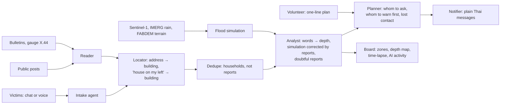

# ReachPoint

**A flood picture that builds itself from what people say.** Victims talk to an AI agent; public posts, official
bulletins, the river gauge and satellite passes come in on their own. A team of agents turns all of it into one live
map for volunteers: who needs help, how deep the water is street by street, where it is heading, and who plans to
come. Then it tells every household what is happening.

AI Builder Cup 2026 (Google Cloud JAPAC) · Sustainability & Social Impact · built 12–18 Oct 2026 by a team of two.

- **Live demo:** _link added at deploy_ · **Video (under 3 min):** _link added on submission_ · **Deck (PDF):** _link added on submission_
- Product spec: [`docs/product/v2-spec.md`](docs/product/v2-spec.md) · Evaluation: [`docs/eval/v2-results.md`](docs/eval/v2-results.md)

## The problem

In the November 2025 Hat Yai flood, tens of thousands of requests for help came in through phone lines, Facebook
groups, LINE and word of mouth ([sources](docs/research/real-rescue-practice.md)). The same family was posted many
times; others never posted at all. Nobody could say how many people were in which street, how deep the water was
there, or whether anyone was on the way. Volunteers drove to houses that had already emptied, while people who never
called were not checked.

## Try it in 60 seconds

Open the site. You get your own private demo room (nobody else sees your reports; Reset only resets yours).

1. **Report as a victim** on the phone on the left, in Thai or English, by typing or holding the mic. Try the sample:
   *"น้ำถึงเอวแล้ว อยู่กับแม่ แม่เดินไม่ได้ บ้านเลขที่ 52/9 ถนนเพชรเกษม ซอย 2"*.
   The agent asks only what is missing; under each answer you see what it understood, with your own words.
2. **Watch your house appear** on the satellite map, and the zone's numbers change.
3. **Answer "is anyone in the house on your left?"** The system finds that house on the map. If it already reported,
   it isn't counted twice; if not, it is added as a household reported by a neighbour.
4. **Post a plan as a volunteer** ("เรือเรา 8 ที่ จะเข้า B-3 ราวบ่ายสอง") and see your phone told that a boat is coming.
5. **Press "Play the flood"** to watch 21–28 Nov 2025: the flood simulation spreads from the canal as the real gauge
   rises, reports arrive, duplicates merge, quiet zones get asked, and the picture sharpens.

## How it works



| Step | What it does | Code |
|---|---|---|
| **Intake agent** | One question at a time, only what is missing: where, how many, who is vulnerable, how deep (with a concrete check: "above or below your door handle?"), then the neighbours side by side. Skips the neighbour questions when life is at risk | [`api/v2/intake.py`](api/v2/intake.py) |
| **Reader** | A language model turns any message into facts. Every fact must quote the person's exact words or it is dropped. Rules take over if the model is unavailable, and say so | [`api/v2/ai.py`](api/v2/ai.py), [`reader.py`](api/v2/reader.py) |
| **Locator** | Address → Pinpoint → the Google Open Buildings outline under it. "The house on my left" → the building on that side, as seen from the door looking at the street (OSM street direction) | [`api/v2/geo.py`](api/v2/geo.py) |
| **Dedupe** | Counts households, not messages. Replies stay in their conversation; a relative's post merges only when exactly one nearby family has the same makeup; otherwise it is kept apart and counted as a range | [`api/v2/pipeline.py`](api/v2/pipeline.py) |
| **Flood simulation** | Diffusive shallow-water model on the 30 m FABDEM terrain: the canal at the real gauge X.44 level hour by hour, the real IMERG rain, drainage | [`data/scripts/build_v2_flood_sim.py`](data/scripts/build_v2_flood_sim.py) |
| **Analyst** | Words → depth ranges; each report is compared with the simulation at its own house; nearby reports' gaps correct the simulation ("reports say 0.6 m deeper here: likely blocked drains"); a report whose gap disagrees with its neighbours is marked doubtful, never deleted | [`api/v2/pipeline.py`](api/v2/pipeline.py), [`level.py`](api/v2/level.py) |
| **Planner, Notifier** | Daily and alert check-ins, early warnings to vulnerable households where the simulated water spreads next, "lost contact" after two missed checks, plan updates to every household in a zone, gaps such as "nobody plans medical help" | [`api/v2/planner.py`](api/v2/planner.py), [`messages.py`](api/v2/messages.py) |

**Which model reads:** Gemini on Vertex AI in the deployed build (`REACHPOINT_LLM=gemini`, the default). During
development the same reader can run on Claude through the Claude Code CLI (`REACHPOINT_LLM=claude`). Every
reading is labelled with the model that made it.

## Measured, not claimed

[`docs/eval/v2-results.md`](docs/eval/v2-results.md), reproduced with `python api/scripts/eval_v2.py`, on the Hat Yai
scenario (real water data, synthetic people and messages, with deliberately wrong reports planted):

| Measure | Result | Target |
|---|---|---|
| Depth at a household, against the true depth there | 0.14 m mean error (median 0.12 m) | ≤ 0.2 m |
| Planted wrong reports flagged doubtful | 13 of 14 | ≥ 80% |
| Honest reports wrongly flagged | 3% | low |
| Two families wrongly merged into one | 1% | ≤ 3% |
| "The house on my left" matched to the exact building | 88% | ≥ 85% |

The scenario's "true" flood is the simulation plus local effects it can't know (blocked drains, pumps, smooth
differences), so these numbers show how well physics and reports combine, not field accuracy.

## Data

| Real | Synthetic |
|---|---|
| River gauge X.44 (RID), IMERG rain, Sentinel-1 flood extent (Earth Engine), FABDEM terrain, Google Open Buildings outlines (30,086 in the city), OSM streets and canals, WorldPop and DOPA population | Every household, message, post, reply and volunteer plan. Bulletins are reconstructed from the real gauge readings and labelled as such |

Never enter real personal data.

## Honest limits

- **Not a hydraulic model.** The simulation has no buildings, pipes, pumps or dykes. It is a first guess that reports
  correct, and it is labelled that way.
- **Synthetic people.** The scenario was written by the team; the evaluation measures behaviour, not field accuracy.
- **Not tried with responders yet.** No drill with a rescue team so far.
- **Messages are simulated.** Check-ins appear in the app; SMS, LINE and phone calls are not connected.
- **Pinpoint:** where the key is not configured, addresses fall back to a street-name match in the city.

## Run it locally

```bash
python -m venv .venv && .venv/bin/pip install -r api/requirements-dev.txt
(cd web && npm ci && VITE_DATA=api npm run build)
.venv/bin/python -m uvicorn api.main:app --port 8093     # http://localhost:8093
.venv/bin/python -m pytest -q api/tests && (cd web && npm test)
```

Rebuild the data: `data/scripts/build_v2_buildings.py`, `fetch_v2_streets.py`, `build_v2_terrain.py` (Earth Engine),
then `build_v2_flood_sim.py`, `build_v2_scenario.py`, `api/scripts/v2_batch_read.py`, `python -m api.v2.board`
(time-lapse summary) and `api/scripts/eval_v2.py`. The earlier role screens (coordinator desk, team screens) are
still in the code at `/classic`.
