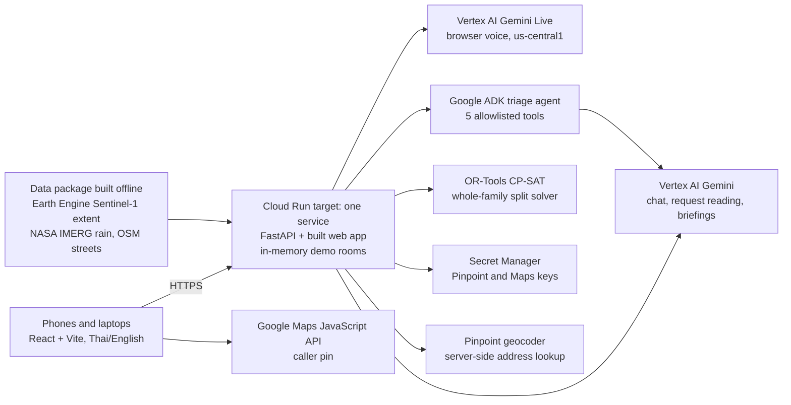

# How ReachPoint works

Current prototype, 13 Oct 2026. Historical flood evidence is real; all households, teams and operations are synthetic. The [README](../README.md) is the judge-facing entry point.

## The flow

1. **Report.** On `/call`, the caller chats or uses browser Gemini Live voice in Thai or English, and can supply GPS, a map pin or an address. The assistant asks for missing facts and reads a summary. Voice submission requires the exact confirmation phrase, checked by the server; it creates a request for review, not a dispatch.
2. **Read and review.** Gemini extracts proposed facts with caller quotes. Code checks quote presence, counts and denied dangers. The ADK agent uses five allowlisted tools to propose duplicate links, clarification questions and reasons. Queue order is deterministic: danger signs first, then oldest. The coordinator reviews; quotes do not prove a report is true.
3. **Take and update.** A team takes whole household groups. Server rules check revision, capacity and competing claims in the in-memory store. The team sets an estimated arrival window and reports progress; the family's status link shows each group's state.
4. **Withdraw stale times.** A reviewed boat failure withdraws affected arrival windows and returns unfinished work to the list. The family sees that the estimate is no longer current and who should update them next.
5. **Check quiet areas.** Zone missions retain unchecked segments even where nobody called. A team checks a segment and submits a field report for review. Partial checks leave gaps open; population exposure estimates never become confirmed household counts.

## Architecture (implemented; deployment pending)

The [deploy script](../scripts/deploy.sh) targets one always-on instance (1 vCPU, 1 GiB) serving web and API. It is ready but has not been deployed. Each visitor gets an in-memory [demo room](../api/server/rooms.py); restart loses changes. Geocoding needs configured keys; live service availability has not been established by this document review.

## Limits and next steps

No Firestore transactions, Firebase Hosting, sign-in or telephone line run in this prototype. A durable database and sign-in remain planned; local SQLite is an open, unmerged PR (#21). A zone-order “Copilot” is planned, not built. The implemented agent proposes intake links/questions; Gemini briefings describe computed zone facts.

[Evaluation](eval/results.md) covers 36 intake and 12 triage synthetic cases, with fallback disclosed. No responder drill or Thai voice accuracy measurement exists. See the proposed [operator and cost model](product/business-case.md) and [judge answers](submission/judge-qa.md).
