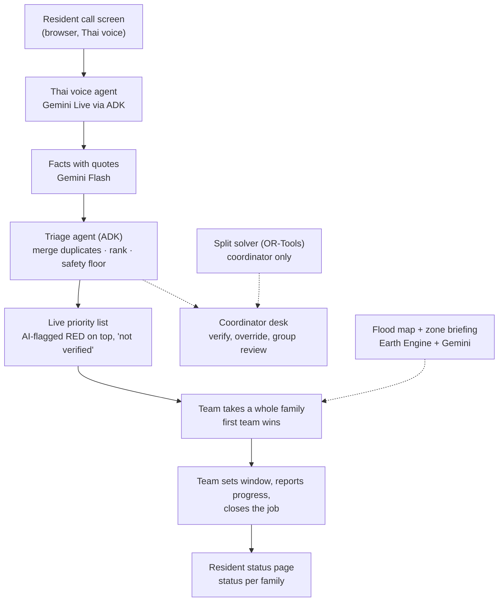
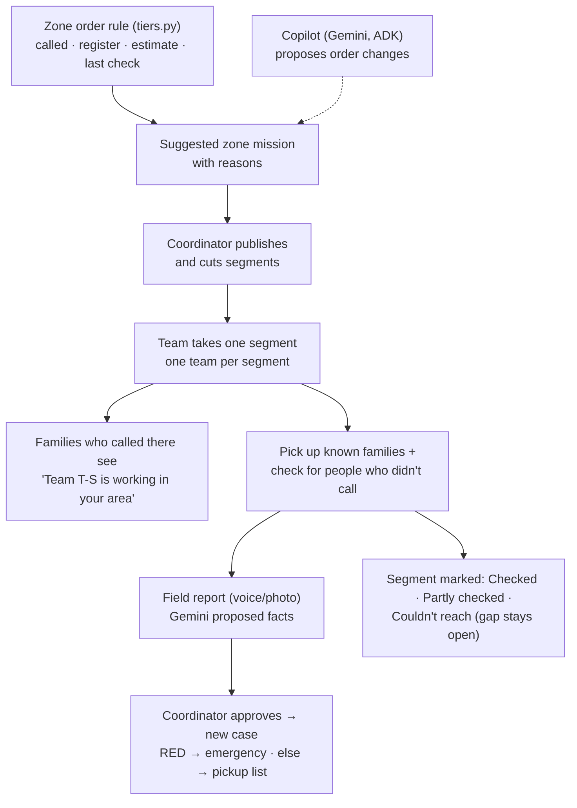
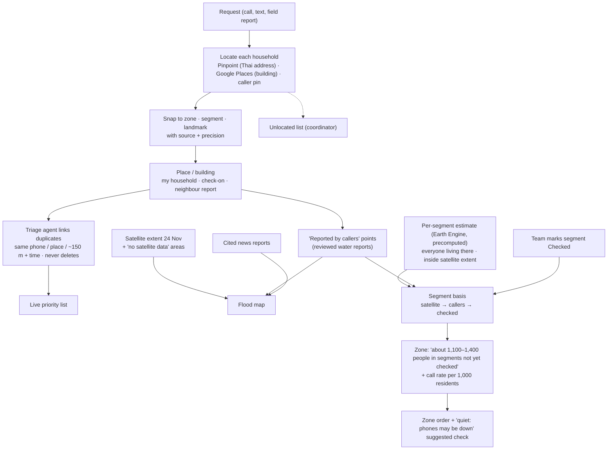
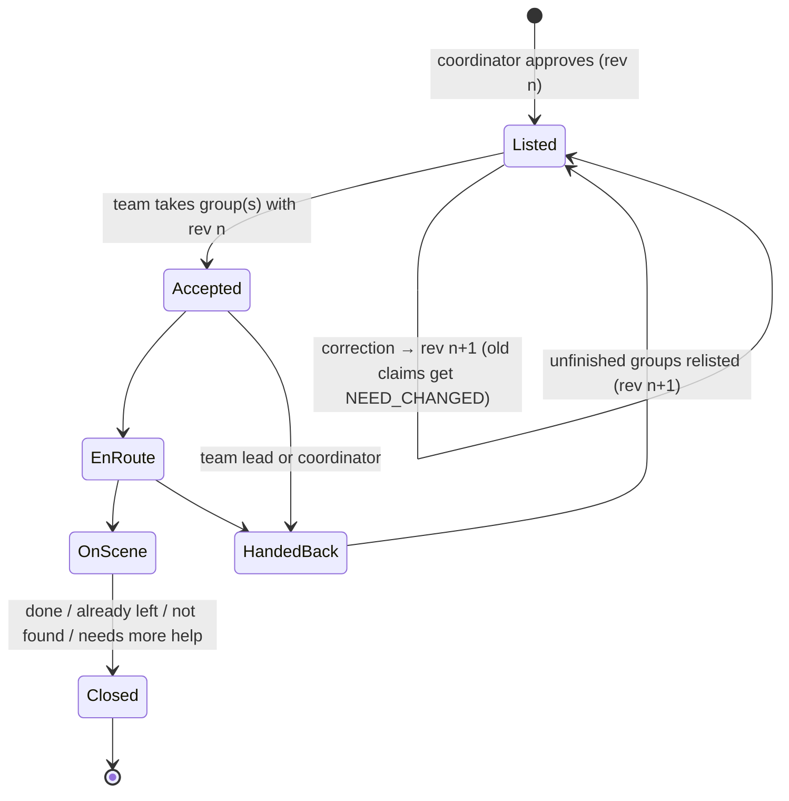

# How ReachPoint works

This is the one-page picture of the whole system. Details live in the [design doc](designs/resource-split-and-live-loop.md) (behaviour and decisions) and the [joint decision pack](planning/joint-decision-pack.md) (contract §3, transitions §4, walk-through §7). For how our parts connect and are tested, see the [integration map](collaboration/integration-map.md). For who builds what, see the [delivery agreement](collaboration/two-person-delivery-agreement.md) and the [build-week task list](planning/build-week-tasks.md).

## Why we built it

In the Nov 2025 Hat Yai flood, **more than 20,000 people asked for help in one week**, and many were never reached. One volunteer team got 1,000+ calls in a single morning. People alone can't read, compare and rank that many requests.

**ReachPoint answers every caller in seconds and puts the most urgent at the top for everyone to see. The rest becomes zone missions, so a handful of people can run a city-wide flood response.**

## What it is

ReachPoint helps volunteer rescue teams decide **who to help first when there aren't enough boats, medics or supplies for everyone**, and it tells each family honestly what is happening with their request.

The demo is set in the real **Hat Yai flood (Nov 2025)**. The flood extent is real, computed from Sentinel-1 satellite radar. Families, teams, calls and quantities are synthetic and labelled as such.

**The rule behind everything:**
- AI can **listen, read, merge and rank** at a scale people can't. Everything it does is labelled ("AI-read", "AI-ranked") with its reasons, and people can always override it.
- **Only people** verify facts, promise a family a time, assign a team or close a request.

## Two kinds of work

- **Emergencies (RED):** a reviewed case with a life threat. It's handled one by one, straight away; the first free capable team to take it goes. This is the C-01 example below.
- **Zone missions:** everything else is prioritised **by zone**, because not everyone in danger calls. A zone such as B-3 is split into **segments** around its landmarks, and each segment is taken by one team. The team picks up the families who called there **and** checks for people who didn't. Families who called see "Team T-S is working in your area today, about 13:00–16:00". Details are in [Zone missions](#zone-missions) below.

## The flow, step by step (emergency example: case C-01)

1. **10:10 Call.** An elderly resident taps one big button and speaks Thai. The AI agent asks one question at a time (where, how many people, what help) and reads the details back to confirm. If live voice fails, the screen falls back to push-to-talk, then to text.
2. **10:12 Proposed facts.** Gemini turns the call into proposals such as "3 people at Community building L3 · evacuation · medical", each with the quote it came from. It may suggest "probably the same as C-01" (already counted in P-B's 24).
3. **10:15 Review.** The coordinator approves or rejects each fact. **Nothing is official before this.** An approved case becomes a **listing** for each help type, with household **groups** (a family stays together by default), a `needRevision` and a "last confirmed" time.
4. **Priority list.** Listings appear in the shared open list for their help type (evacuation, medical, supplies). The order is RED (life-threatening) → YELLOW (urgent) → GREEN (can wait); within a colour, nearest first, then longest waiting. A team that turns Available sees every waiting case. If a RED case is waiting, it also gets a one-time prompt.
5. **10:20 Take.** Team T-S taps "Take" on Families 1+2. One Firestore transaction checks capability, seats, overlap and the revision. Possible results: **accepted**, `ALREADY_TAKEN`, `NOT_ENOUGH_CAPACITY` or `NEED_CHANGED` ("This case changed, please look again"). There are no offers and no timers; nothing is reserved before a team takes it.
6. **Window and progress.** T-S sets 13:00–14:00. Only now does the resident see a window, **per family**, e.g. "Family 1: boat on the way 13:00–14:00 · Family 3: still looking for a team". The team then reports progress: en route → on scene.
7. **End of the job.** The job ends as **Done / Already left or helped by others / Not found / Needs more help**. With "Needs more help", only the remaining part goes back on the list.
8. **10:30 Boat S1 fails.** T-S reports it. After the coordinator reviews, the engine does four things:
   - holds the job;
   - puts **only the unfinished families** back on the list;
   - withdraws the old window;
   - marks the resident message "No longer current" and shows "Update needed" on the desk.

   The resident sees "On hold · next update 11:00 from the coordinator desk". Unrelated jobs are untouched.
9. **Replan.** The coordinator's split panel shows the solver's new suggestion. "Ask these N teams" sends each team a direct "Can you take this?". Teams still take cases themselves.

## Zone missions

**Zone order:**
1. RED emergencies always come first.
2. Zones are then ordered by:
   1. reviewed people who called and still need help;
   2. vulnerable residents on the (synthetic) register;
   3. estimated people in segments not yet checked (per-segment estimate, D27–D28; low call rate flags a quiet zone);
   4. time since the last check.

The estimate only orders zones; it never adds to counts. The copilot can propose a change, e.g. "move B-5 up: calls dropped, phones may be down", but only the coordinator can accept it.

**Demo scene, "found a family who never called":**
1. B-4 has no calls, ~800 people in the flooded part and 2 bedridden residents on the register. A check is suggested and the coordinator publishes it.
2. T-R takes segment B-4 · L5.
3. T-R reports "elderly couple on the 2nd floor, one bedridden".
4. The coordinator approves case C-07 (RED), and T-S takes it.
5. The segment is marked "Partly checked · 1 household found".

## How requests meet the flood map and the estimate

- **Locating (D25).** Every household gets an exact point, with its source and precision. Only the coordinator and the team that **took** the job see that point, which comes with a "Navigate" link. Everyone else sees the segment and landmark only. Requests that can't be placed go to an unlocated list; nothing is dropped.
- **Headcounts (D29).** Each request is one of three kinds: **my household** (counted), **someone else's household** (a "check on" entry, counted once confirmed) or **what I can see** (a neighbour report). Requests from one building or address become one **place**, and a condo becomes one building job. Neighbour reports are never added up. The place shows, for example, "at least 20 (largest single report)" next to the confirmed count, and the team on site records the real number.
- **Satellite vs callers (D26).** Areas the radar can't see are "no satellite data", never dry. The satellite can raise concern but never lower it. Reviewed water reports become live "reported by callers" points on the map.
- **Estimate (D27–D28).** Each segment has two precomputed ranges: everyone living there, and people inside the satellite extent. A reviewed water report from a "no data" segment switches it to the full count. A checked segment drops out of "not yet checked". A low call rate flags a quiet zone. The district total is checked against GISTDA's figure (about 150,000 people affected).

## A job's lifecycle

A closed allocation rejects late updates with `ALLOCATION_CLOSED`. Supplies marked "delivered, not confirmed" never go back on the list automatically; the coordinator decides.

## Components and owners

| Layer | User (map, solver, team) | Friend (intake, desk, backend) | Both |
|---|---|---|---|
| Screens (React, Firebase Hosting) | Map + zone briefing · Team list + mission · Split panel · **frontend foundation** (shell, tokens, components, data hooks) | Call screen · Coordinator desk · Resident status | — |
| Server (FastAPI, Cloud Run) | Split solver (`allocation.py`) · Tiers + sort (`tiers.py`) · Briefing prompts | Rules engine (`transitions.py`) · Voice agent · Fact extraction · Tool layer · Message rules | Copilot (friend runs it; user writes instructions and tool choice) |
| Data and services | Flood + exposure package (Earth Engine → GeoJSON) | Firestore + views · Auth · `reachpoint-main` · deploy | Contract (`api/contract/`) |

## Where the AI is

| AI | Does | Limit |
|---|---|---|
| Thai voice agent (Gemini Live + ADK) | Holds the call, clarifies, reads back; many calls in parallel | Extracts facts; doesn't decide |
| **Triage agent (Gemini + ADK)** | Compares every request against the list, links duplicates by place (never deletes), ranks and updates the live list | Labelled "AI-ranked" with reasons; safety floor; human overrides win; never closes, promises or assigns |
| Fact extraction (Gemini Flash) | Calls and team reports → facts with quotes | A human approves each one |
| Coordinator copilot (Gemini + ADK) | "What changed since 10:00?", with record IDs | Read-only; drafts need a human click |
| Split solver (OR-Tools) | Best split of boats, medics and packs; "What if one more boat?" | Coordinator only; suggestions become direct asks |
| Zone briefing (Gemini) | Two-sentence summary from computed numbers | No route, depth or priority claims |
| Flood extent (Earth Engine) | Sentinel-1 change detection, precomputed | Dated; urban areas may be under-detected |

## The map in one paragraph

The map has three levels: areas P-A/P-B/P-C → zones B-1…B-5 → segments around landmarks (L1–L3, D1). Shared map markers sit at landmarks, never at houses. Only the coordinator and the team that took a job see its exact point (D25). Radar blind spots are shown as "no satellite data", and reviewed caller reports of water are drawn on top (D26). Each zone briefing shows facts, an **Unknown** row (unknown is never zero), the cases in the zone, and an **estimated range** of people in segments not yet checked. That range comes from Open Buildings + WorldPop + DOPA, sits next to the reviewed count, and never creates a case. Details: pack §5.1b–c.

## Main records (full shapes in pack §3)

- `reports`, `proposedEvents`: raw calls and AI proposals. Each report has a kind: my household, check-on, or neighbour report (D29).
- `places`: a building or address with its linked reports, confirmed count and "at least N" neighbour floor; `location` = point, source, precision, zone/segment/landmark (D25).
- `cases`, `assistance`: reviewed facts.
- `listings` (per case × help type, with groups, `needRevision`, `lastConfirmedAt`).
- `allocations` (per claimed group: team, window, status, outcome).
- `teams`, `resources` (status Available / Busy / Off duty, with an optional reason and "back about").
- `submissions`: idempotency.
- `history`: append-only audit.
- `views/*`: derived per role, regenerated in the same transaction. They include the open list per help type, the desk, the team view and the resident status by token.

## Checkpoints

| Checkpoint | Date | Done when |
|---|---|---|
| CP0 | Mon 12 | Both apps are deployed and the contract is frozen |
| CP1 | Tue 13 | A text report is approved and shows on the map, with the count unchanged |
| CP2 | Wed 14 | A team takes Families 1+2 and the resident sees the window per family |
| CP3 (+ surge) | Thu 15 | The full walk-through runs, including the S1 failure and the B-4 "found a family who never called" scene |

Feature freeze is Fri 16 at 18:00. Submit by Sat 17, 21:00 Bangkok.
