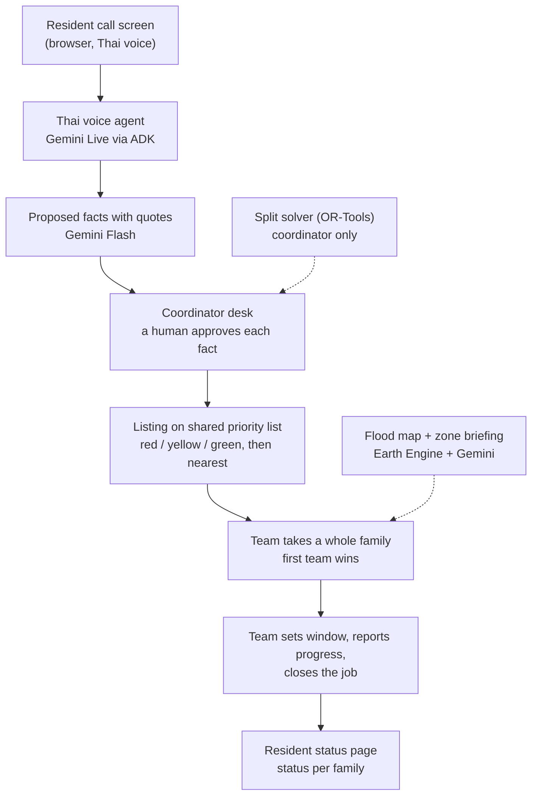
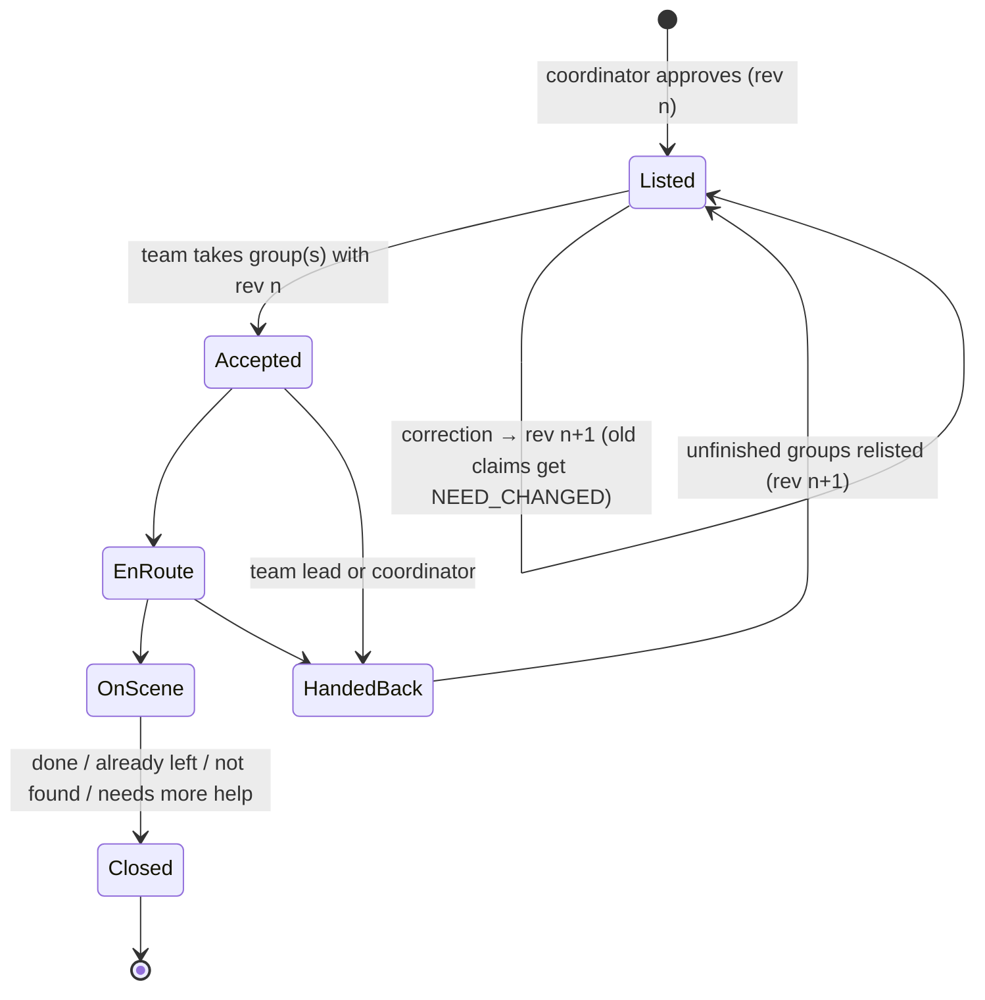

# How ReachPoint works

This is the one-page picture of the whole system. Details live in the [design doc](designs/resource-split-and-live-loop.md) (behaviour and decisions) and the [joint decision pack](planning/joint-decision-pack.md) (contract §3, transitions §4, walk-through §7). For who builds what, see the [delivery agreement](collaboration/two-person-delivery-agreement.md) and the [build-week task list](planning/build-week-tasks.md).

## What it is

ReachPoint helps volunteer rescue teams decide **who to help first when there aren't enough boats, medics or supplies for everyone**, and it tells each family honestly what is happening with their request.

The demo is set in the real **Hat Yai flood (Nov 2025)**. The flood extent is real, computed from Sentinel-1 satellite radar. Families, teams, calls and quantities are synthetic and labelled as such.

**The rule behind everything:** AI can listen, suggest and explain, but only a person changes what is true. Every AI tool is read-only or proposal-only.

## The flow, step by step (example: case C-01)

1. **10:10 Call.** An elderly resident taps one big button and speaks Thai. The AI agent asks one question at a time (where, how many people, what help) and reads the details back to confirm. If live voice fails, the screen falls back to push-to-talk, then to text.
2. **10:12 Proposed facts.** Gemini turns the call into proposals such as "3 people at Community building L3 · evacuation · medical", each with the quote it came from. It may suggest "probably the same as C-01" (already counted in P-B's 24).
3. **10:15 Review.** The coordinator approves or rejects each fact. **Nothing is official before this.** An approved case becomes a **listing** for each help type, with household **groups** (a family stays together by default), a `needRevision` and a "last confirmed" time.
4. **Priority list.** Listings appear in the shared open list for their help type (evacuation, medical, supplies). The order is RED (life-threatening) → YELLOW (urgent) → GREEN (can wait); within a colour, nearest first, then longest waiting. A team that turns Available sees every waiting case. If a RED case is waiting, it also gets a one-time prompt.
5. **10:20 Take.** Team T-S taps "Take" on Families 1+2. One Firestore transaction checks capability, seats, overlap and the revision. Possible results: **accepted**, `ALREADY_TAKEN`, `NOT_ENOUGH_CAPACITY` or `NEED_CHANGED` ("This case changed, please look again"). There are no offers and no timers; nothing is reserved before a team takes it.
6. **Window and progress.** T-S sets 13:00–14:00. Only now does the resident see a window, **per family**, e.g. "Family 1: boat on the way 13:00–14:00 · Family 3: still looking for a team". The team then reports progress: en route → on scene.
7. **End of the job.** The job ends as **Done / Already left or helped by others / Not found / Needs more help**. With "Needs more help", only the remaining part goes back on the list.
8. **10:30 Boat S1 fails.** T-S reports it. After the coordinator reviews, the engine does four things:
   - holds the job;
   - puts **only the unfinished families** back on the list;
   - withdraws the old window;
   - marks the resident message "No longer current" and shows "Update needed" on the desk.

   The resident sees "On hold · next update 11:00 from the coordinator desk". Unrelated jobs are untouched.
9. **Replan.** The coordinator's split panel shows the solver's new suggestion. "Ask these N teams" sends each team a direct "Can you take this?". Teams still take cases themselves.

## A job's lifecycle

A closed allocation rejects late updates with `ALLOCATION_CLOSED`. Supplies marked "delivered, not confirmed" never go back on the list automatically; the coordinator decides.

## Components and owners

| Layer | User (map, solver, team) | Friend (intake, desk, backend) | Both |
|---|---|---|---|
| Screens (React, Firebase Hosting) | Map + zone briefing · Team list + mission · Split panel · **frontend foundation** (shell, tokens, components, data hooks) | Call screen · Coordinator desk · Resident status | — |
| Server (FastAPI, Cloud Run) | Split solver (`allocation.py`) · Tiers + sort (`tiers.py`) · Briefing prompts | Rules engine (`transitions.py`) · Voice agent · Fact extraction · Tool layer · Message rules | Copilot (friend runs it; user writes instructions and tool choice) |
| Data and services | Flood + exposure package (Earth Engine → GeoJSON) | Firestore + views · Auth · `reachpoint-main` · deploy | Contract (`api/contract/`) |

## Where the AI is

| AI | Does | Limit |
|---|---|---|
| Thai voice agent (Gemini Live + ADK) | Holds the call, clarifies, reads back | Proposes only |
| Fact extraction (Gemini Flash) | Calls and team reports → facts with quotes | A human approves each one |
| Coordinator copilot (Gemini + ADK) | "What changed since 10:00?", with record IDs | Read-only; drafts need a human click |
| Split solver (OR-Tools) | Best split of boats, medics and packs; "What if one more boat?" | Coordinator only; suggestions become direct asks |
| Zone briefing (Gemini) | Two-sentence summary from computed numbers | No route, depth or priority claims |
| Flood extent (Earth Engine) | Sentinel-1 change detection, precomputed | Dated; urban areas may be under-detected |

## The map in one paragraph

The map has three levels: areas P-A/P-B/P-C → zones B-1…B-5 → landmarks (L1–L3, D1). Emergency markers sit at landmarks, never at houses. Each zone briefing shows facts, an **Unknown** row (unknown is never zero), the cases in the zone, and an **estimated range** of people living in the flooded part. That range comes from Open Buildings + WorldPop + DOPA, sits next to the reviewed count, and never creates a case. Details: pack §5.1b–c.

## Main records (full shapes in pack §3)

- `reports`, `proposedEvents`: raw calls and AI proposals.
- `cases`, `assistance`: reviewed facts.
- `listings` (per case × help type, with groups, `needRevision`, `lastConfirmedAt`).
- `allocations` (per claimed group: team, window, status, outcome).
- `teams`, `resources` (status Available / Busy / Off duty, with an optional reason and "back about").
- `submissions`: idempotency.
- `history`: append-only audit.
- `views/*`: derived per role, regenerated in the same transaction. They include the open list per help type, the desk, the team view and the resident status by token.

## Checkpoints

| Checkpoint | Date | Done when |
|---|---|---|
| CP0 | Mon 12 | Both apps are deployed and the contract is frozen |
| CP1 | Tue 13 | A text report is approved and shows on the map, with the count unchanged |
| CP2 | Wed 14 | A team takes Families 1+2 and the resident sees the window per family |
| CP3 | Thu 15 | The full walk-through runs, including the S1 failure |

Feature freeze is Fri 16 at 18:00. Submit by Sat 17, 21:00 Bangkok.
