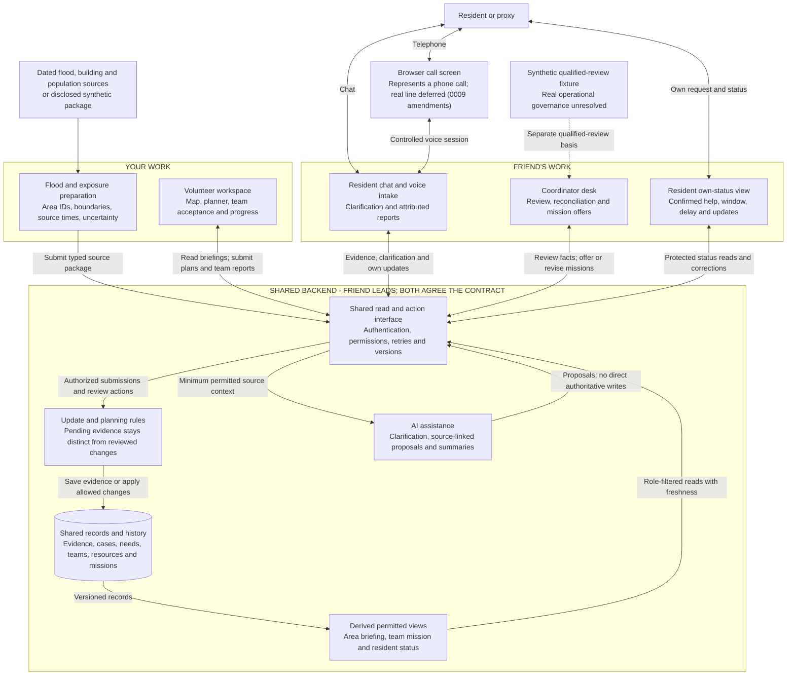

# ReachPoint — proposed architecture and connections

Date: 2026-10-11. **Logical architecture.** The physical mapping (Cloud Run API, Firestore, Firebase Hosting/Auth, Vertex AI, Maps, offline Earth Engine) is set in [decision 0009](../decisions/0009-implementation-start-and-technical-direction.md); the logical rules here are unchanged. Accepted product scope and human work split remain in [scope v1](../product/prototype-scope-v1.md) and [decision 0006](../decisions/0006-two-person-work-split.md). The architecture recommendation is recorded as **proposed** in [decision 0007](../decisions/0007-logical-architecture-proposal.md). Boxes describe responsibilities, not separate deployed services. Nothing in this diagram is implemented.

## Whole-system diagram

Solid arrows show intended data/actions/responses. The dashed qualified-review input is a clearly labeled synthetic fixture for the prototype, not an established clinical/rescue partner or protocol. Telephone access and source-backed data each have separate feasibility/authorization gates.



The key connection is the **shared read/action interface**. Your map and your friend's coordinator screen use the same case, area, team and mission references. Neither UI maintains independent mission truth or changes a final table directly. The backend saves pending evidence, performs appropriate permission/version checks and applies reviewed facts and allowed team actions. AI has no direct write path to authoritative cases, quantities or assignments.

The volunteer map combines **your typed flood/exposure package** with **permitted reviewed operational data** from the shared backend. Satellite extent/buildings/exposure do not establish current occupancy, trapped people, evacuation demand or safe routes. A response-mode label comes from a scoped reviewed assessment, with source/time/unknowns; the flood-preparation box cannot manufacture that assessment.

## What each backend box means

| Box | Responsibility | Developer lead |
|---|---|---|
| Shared read/action interface | The operations in the [draft integration contract](../collaboration/volunteer-backend-contract-v1.md): read briefings/evidence/own missions; submit packages/proposals/reports; accept offers and acknowledge briefs. Determine actor permissions and handle duplicate submissions/conflicts. | Friend; both review contract |
| AI assistance | Use minimum permitted source context to clarify a report, propose attributed events/associations or summarize evidence and missing questions. Store proposals as pending evidence where appropriate; translation preserves original meaning. No autonomous clinical decisions or authoritative totals. | Friend for intake; area-summary behavior agreed with You |
| Update and planning rules | Reconciliation/review, allowed mission transitions, capability/resource/readiness checks and versioned changes. Apply the same planning arithmetic used by the planner preview; no second conflicting calculation. | Friend owns state rules; You own planning-rule definition; both review |
| Shared records/history | Logical storage for source versions, pending evidence and reviewed facts, provisional associations, teams/resources, proposals/missions, acknowledgments and distinct outcome evidence. Preserve corrections/history. No raw recordings by default. | Friend owns persistence; You supply geospatial/source inputs |
| Derived permitted views | Compute area coverage/assessment gaps, own-team briefs and own-resident status from current reviewed records and accepted plans. Expose input versions, uncertainty and freshness. Whether computed on read or cached remains open. | You define area summary; Friend integrates reads and resident state |

“Shared records” is one logical authority boundary, not a claim that everything belongs in one physical table. Geometry/source assets may later need different storage from structured records. Their identifiers and versions must still align. The AI/rules/views boxes can be modules in one backend; the diagram does not require a microservice deployment.

## Emergency-to-help connection

This sequence shows a synthetic emergency flow. Routine proposals follow the same shared boundary, with the leader proposing and the coordinator reviewing scope/readiness.

```mermaid
sequenceDiagram
    participant R as Resident or proxy
    participant I as Friend intake
    participant B as Shared backend and records
    participant C as Friend coordinator desk
    participant V as Your team mission view
    participant S as Friend resident status

    R->>I: Chat or genuine controlled inbound call
    I->>B: Attributed report and source-linked proposals
    B-->>C: Pending evidence, suspected urgency and owner
    C->>B: Review facts and scoped qualified fixture separately
    C->>B: Offer suitable mission after explicit checks
    B-->>V: Team-specific offer and saved brief
    B-->>S: No accepted team; arrival unknown
    V->>B: Accept current offer and provide responsible window
    V->>B: Acknowledge saved brief version
    B-->>S: Accepted assistance and its current window
    R->>S: Read protected own-request status
    V->>B: Report unavailable resource or delay
    B-->>C: Pending problem and linked mission attention
    C->>B: Review; hold or revise linked mission
    B-->>V: Current state and revised brief; new acknowledgment needed
    B-->>S: Old window withdrawn; replacement unknown if unknown
```

Transport and medical assistance have separate acceptance/window states. Acceptance, preparing, reported en-route, delivery report, confirmed receipt and confirmed care remain distinct. A routine area trip cannot establish that a specific household is included without scope evidence. A team report is not automatically a reviewed case correction or confirmed outcome.

## How flood data and field discoveries connect

1. You prepare the bounded source package: area/boundary IDs, typed evidence and acquisition/observation times, units/reference, method and uncertainty. A disclosed synthetic fixture demonstrates behavior only.
2. Your source submission passes the shared publication/version checks. Published evidence keeps its original time; an updated fetch does not make old observations new.
3. The briefing view combines this evidence with reviewed needs/assessments and matching receipt/commitment records. Planning quantities identify cohort, units and period; unknown overlap prevents exact totals.
4. Your volunteer view submits field evidence about a particular scope. It enters the same review pipeline as resident/proxy reports, even when nobody in the area contacted the desk.
5. Following review, only the supported scope changes. One building visit cannot mark the whole area assessed; modeled exposure is never silently converted into identified victims.

Basemap tiles, if a provider is later selected, are background presentation assets used by the map. They do not supply authoritative depth or reviewed needs. Tile/layer failure preserves the list and permitted source/task detail.

## Boundaries and choices still open

Recommended for the small prototype: one logical backend and shared contract, a bounded source package, one AI proposal path and narrowly scoped views. Keep phone/source feasibility early; do not add unrelated channels, continuous feeds, automatic routes/ETAs or a separate administration platform.

Still open: frontend framework, Google AI component/model, hosting, datastore/asset storage, telecom provider/number/region, basemap/source licenses, access/recovery policy, immediate-versus-reviewed update details, refresh mechanism, regions/costs and real operating governance. No automatic outbound SMS/callback/push is shown; those remain deferred. This diagram proposes responsibilities and connections, not vendor availability or a deployed capability. Verify current official documentation before selecting actual components.

To implement later, begin with reviewed text intake → permitted need on the map, then coordinator offer → team acceptance/window → resident status, followed by delay and field-discovery checks. That order comes from the [delivery agreement](../collaboration/two-person-delivery-agreement.md); separate implementation/account authorization is still required.

## Validation

Checks run: six changed/new Markdown files, 55 local links/fragment targets, whitespace and sensitive-pattern scans; all passed. The two Mermaid blocks have matched fences and their node/participant references were checked; no direct AI-to-authoritative-store edge exists. `git diff --check` passed, with separate file scans for this checkout's untracked documents. Mermaid rendering was not runtime-verified, and no application tests or integrations ran. The diagrams describe the proposed system, not implemented capabilities.
